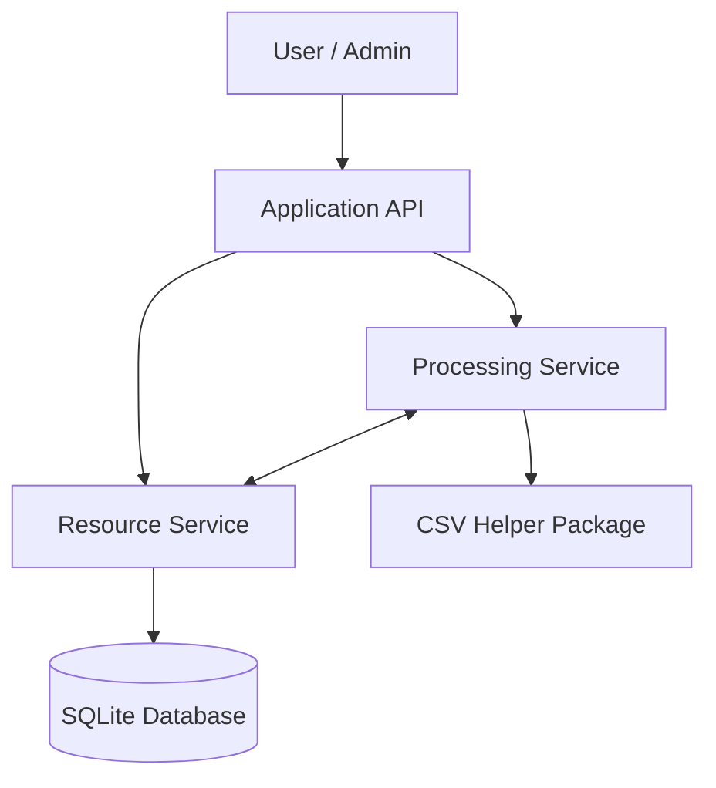

# System Architecture

## Overview
Research Workspace consists of three separate Python services that communicate through HTTP APIs.

Each service has its own responsibility. The goal is to keep dataset storage, authentication, and processing separate so that permissions can be checked at the relevant boundaries.

## Components

### Application API (Port 8000)

- Handles user login and authentication.
- Receives requests from users.
- Coordinates requests between services.
- Forwards requests using restricted authorization.

### Resource Service (Port 8001)

- Stores private datasets and export results.
- Stores audit logs.
- Checks dataset ownership and permissions.
- Uses SQLite for data storage.

### Processing Service (Port 8002)

- Handles CSV export jobs.
- Requests authorized datasets from the Resource Service.
- Uses a separate installable CSV helper package.
- Returns generated exports to the Resource Service.

## Architecture Diagram

## Communication

The three services will run as separate processes and communicate through HTTP.

The Application API will be the entry point for users. The Resource Service will be responsible for enforcing permissions on datasets, including requests coming from other services.

The Processing Service will receive limited authorization for individual export jobs instead of unrestricted access to the Resource Service.
The exact API endpoints and authorization mechanism will be defined before implementation.

## Data Flow

The main operations are creating, viewing, and exporting datasets.

### Creating a Dataset

1. The user sends a request to the Application API.
2. The API authenticates the user and forwards the request to the Resource Service.
3. The Resource Service checks permissions and saves the dataset in SQLite.
4. The result is returned to the user through the API.

### Viewing a Dataset

1. The user requests a dataset through the Application API.
2. The Resource Service checks whether the dataset belongs to the user.
3. If access is allowed, the dataset is returned.
4. Otherwise, the request is denied.

### Exporting a Dataset

1. The user requests an export through the Application API.
2. The API authenticates the user and starts an export job in the Processing Service.
3. The Processing Service requests the dataset from the Resource Service.
4. The Resource Service verifies the delegated permission and dataset ownership.
5. The Processing Service generates a CSV file using the helper package and saves it through the Resource Service.
6. The user retrieves the export through the Application API after authorization is checked.

This workflow involves all three services.

### Viewing Audit Logs

1. The administrator requests the audit logs through the Application API.
2. The Resource Service verifies the administrator's role.
3. The logs are returned if access is allowed.

Regular researchers cannot access audit logs.

## Trust Boundaries

The system has several trust boundaries where requests has to be checked.

### TB1: User to Application API

The API cannot trust incoming requests.

Users must authenticate and their inputs must be validated. A user must not be able to gain additional permissions by changing a request.

### TB2: Application API to Resource Service

The Resource Service must not assume that every request from the Application API is authorized.

It must verify the requester's identity, permissions, and access to the requested resource.

### TB3: Application API to Processing Service

The Processing Service must only accept authorized jobs.

Export jobs should contain limited permissions for a specific operation and dataset.

### TB4: Processing Service to Resource Service

The Resource Service must verify both the calling service and the delegated user authorization.

Being a trusted service does not mean having access to every dataset.

### TB5: Processing Service to Helper Package

The helper package is treated as an external dependency.

It should only receive the data needed to generate the requested export and should not have unrestricted access to other resources.

## Authorization Between Services

We plan to use signed, timelimited tokens to carry authorization information between services.

For export jobs, authorization will be limited to the requested dataset and operation. The Resource Service will verify the token and check dataset ownership before returning data or accepting export results.

The exact token structure and validation will be defined during implementation design.
